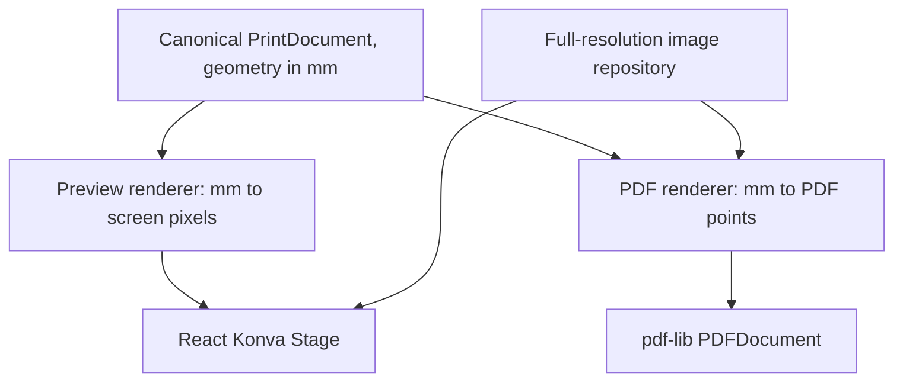

# SDMS Print Studio — Practical Developer Guide

**Version:** 1.0 | **Date:** 2026-11-09  
**Audience:** Solo developer / front-end development team  
**Stack:** Next.js App Router, React, TypeScript, Tailwind CSS v4, shadcn/ui, React Konva, Zustand, pdf-lib  
**Companion docs:** [`PLAN.md`](./PLAN.md), [`TASKS.md`](./TASKS.md)

> The workspace includes a working local Quick Print build. The guide also describes patterns for later milestones, including the designer and saved projects. See [TASKS.md](./TASKS.md) for release gates.

## Contents

1. Developer rules and invariant design
2. Quick start on Windows
3. Package and directory layout
4. Domain types and template fixtures
5. Geometry helpers and grid algorithm
6. Image ingestion and source-accurate cropping
7. Zustand editor store and history
8. React Konva integration
9. PDF generator and download
10. Print preflight and calibrations
11. Local persistence and template versioning
12. Testing and CI
13. Error handling, security, performance and accessibility
14. Build order and extension roadmap
15. Official documentation

---

## 1. Developer rules: do these before anything else

The print correctness model must not depend on browser canvas dimensions.

1. All persistent page and element geometry uses **mm**, with origin at **top-left**.
2. `PrintDocument` JSON is the **single source of truth**. React Konva is a view/controller, not the saved document.
3. PDF renderer reads the same model, converts millimeters to PDF points (`72 pt = 1 in`), and maps Y coordinates to bottom-left.
4. Photos have separate low-resolution thumbnails and full-resolution source files. Never export the editor thumbnail, canvas screenshot, or stage at display resolution.
5. All image crop coordinates refer to a **normalized, full-resolution source image** in **pixels**, not to stage preview pixels.
6. Make components client-only if they access `window`, DOM canvas APIs, IndexedDB, or Konva. Server Components must not read shared Zustand editor state.
7. Do not persist source image blobs, `File` objects, HTMLImageElement, Konva nodes, or object URLs inside document JSON/history.
8. Fail loudly for unsupported element types or missing assets. Never silently omit artwork from exported PDFs.
9. Tests must check **PDF sizes and physical print calibration**, not merely that a PDF exists.
10. Never claim government-ID-photo compliance or commercial PDF/X/CMYK certification unless separately tested and supported.

### Design decision: renderer division



The layout engine does not know about React, Konva, Next.js, or pdf-lib.

---

## 2. Quick start (Windows / PowerShell)

### Run the local Studio

From this folder, run:

```powershell
corepack pnpm install
corepack pnpm dev
```

Open [Quick Print](http://127.0.0.1:3000/quick-print). Run `corepack pnpm lint`, `corepack pnpm typecheck`, `corepack pnpm test`, and `corepack pnpm build` to check the build.

For a first print check, choose 2 × 2 in, add a photo, and set 12 copies on A4. Keep the 5 mm margin and 3 mm gap. Export the PDF and print at **Actual size / 100%**. Measure the squares against 50.8 mm.

For a mixed sheet, upload a photo and choose its print size in the photo list. Use **+** to add another size of the same photo. Each entry has independent copies and crop settings. The starting size applies to new uploads, while **Apply to all** sets the same size on every entry. A practical check is four 2×2, eight 1×1, and one 3R print together on A4.

To reduce a job to one sheet, enable **Fit all prints to one sheet** under the sheet settings. The app uses one scale for every photo, keeps the chosen margins and gaps, and shows the resulting printed dimensions under each entry. Sixteen 2×2 prints on A4 with a 5 mm margin and 3 mm gap become 47.75 × 47.75 mm each. Turn the option off to restore the selected physical sizes and regular pagination.

Use the sliders button beside a photo to edit brightness and contrast. The dialog previews changes, can show the original for comparison, and has Reset, Cancel, and Apply edits controls. Applied settings affect that entry and all its copies. Other entries retain their own settings.

Adjustment values are optional document metadata, with zero as the neutral default. Preview filters and export use the same brightness-then-contrast transformation. Edited exports process the normalized source at its full pixel dimensions and encode a lossless PNG. The PDF cache keys include the source ID and both adjustment values so differently edited copies stay independent. Original source blobs remain available for resetting.

### Prerequisites

- Recent supported Node.js (Next.js documentation lists **20.9+ minimum**; use a maintained LTS compatible with your chosen packages).
- `pnpm` with a project-level lockfile; VS Code; current Chrome/Edge.
- A ruler/caliper and target printers for physical verification.
- Internet for package installation only; the MVP print workflow runs locally after load.

These scaffold commands are for a new checkout without an app.

```powershell
node --version
pnpm --version
pnpm create next-app@latest sdms-print-studio --ts --tailwind --eslint --app --src-dir --import-alias "@/*"
cd sdms-print-studio
pnpm dlx shadcn@latest init
pnpm dlx shadcn@latest add button dialog tabs input label select slider card dropdown-menu tooltip sheet progress sonner separator
pnpm add konva react-konva zustand pdf-lib zod idb lucide-react nanoid
pnpm add -D vitest jsdom @testing-library/react @testing-library/jest-dom @playwright/test
pnpm dev
```

Install **react-konva matching the React major version**. If the scaffold uses React 19, install a React-19-compatible major. React Konva's official documentation says its major version should match the React major version. Always inspect `pnpm list react react-konva konva` and peer-dependency warnings.

If Next's scaffold already configured Tailwind, **do not duplicate** the PostCSS setup. Tailwind v4 uses `@import "tailwindcss";` in the global stylesheet and `@tailwindcss/postcss` when configured manually.

**Future optional packages:** `@pdf-lib/fontkit` for custom fonts, a ZIP library for portable projects, and `sharp` for optional server-side image processing. Do not add server dependencies until needed.

### Scripts (`package.json` excerpt)

```json
{
  "scripts": {
    "dev": "next dev",
    "build": "next build",
    "start": "next start",
    "lint": "eslint",
    "typecheck": "tsc --noEmit",
    "test": "vitest run",
    "test:watch": "vitest",
    "test:e2e": "playwright test"
  }
}
```

Add Vitest config and Playwright config before running the test scripts. On Windows, run PowerShell as normal user; WSL is optional, not required.

---

## 3. Suggested source tree

```text
sdms-print-studio/
├── src/
│   ├── app/
│   │   ├── page.tsx
│   │   ├── templates/page.tsx
│   │   ├── quick-print/page.tsx
│   │   ├── editor/[projectId]/page.tsx
│   │   ├── layout.tsx
│   │   └── globals.css
│   ├── components/
│   │   ├── ui/                  # shadcn-generated
│   │   ├── quick-print/
│   │   ├── editor/
│   │   │   ├── EditorShell.tsx
│   │   │   ├── EditorCanvas.tsx
│   │   │   ├── CanvasElement.tsx
│   │   │   ├── ElementTransformer.tsx
│   │   │   └── PropertiesInspector.tsx
│   │   └── print/
│   ├── features/
│   │   ├── documents/
│   │   │   ├── types.ts
│   │   │   ├── schema.ts
│   │   │   └── migrations.ts
│   │   ├── assets/
│   │   │   ├── repository.ts
│   │   │   ├── import-image.ts
│   │   │   ├── crop-image.ts
│   │   │   └── thumbnail.ts
│   │   ├── editor/
│   │   │   ├── editor-store.ts
│   │   │   ├── editor-context.tsx
│   │   │   └── snap.ts
│   │   ├── layout/
│   │   │   ├── uniform-grid.ts
│   │   │   └── mixed-packing.ts  # later
│   │   ├── print/
│   │   │   ├── export-pdf.ts
│   │   │   ├── preflight.ts
│   │   │   ├── cut-marks.ts
│   │   │   └── paper-presets.ts
│   │   └── templates/
│   │       └── presets.ts
│   └── lib/
│       └── units.ts
├── tests/
│   ├── unit/
│   ├── integration/
│   └── e2e/
├── public/
├── PLAN.md
├── TASKS.md
└── DEVELOPER_GUIDE.md
```

### Component responsibility guide

| Component | Responsibility | Must not do |
| --- | --- | --- |
| `TemplateGallery` | Display/search/select templates | PDF rendering |
| `QuickPrintWizard` | Orchestrate upload→crop→copies→export | Page math directly |
| `ImageUploadQueue` | File import progress, reorder, count | Store image bytes in React/Zustand JSON |
| `CropDialog` | View source and choose normalized crop | Save crop based on thumbnail dimensions |
| `EditorCanvas` | Render mm model using stage scale | Own master document state |
| `CanvasElement` | Render each element subtype, emit transformations | Calculate PDF positions |
| `PropertiesInspector` | Numeric editing, locks, styles | Mutate Konva node only |
| `LayersPanel` | Order/lock/hide elements | Save raw Stage JSON |
| `PrintPreview` | Present sheets and preflight | Promise pixel-perfect color matching |
| `ExportDialog` | Configure export and trigger PDF generation | Rasterize entire stage |
| `PreflightPanel` | Display and navigate issues | Modify photos without user intent |

---

## 4. Domain model (TypeScript starter types)

The following is a recommended **version 1 document shape**. Define its Zod schemas beside it; use `z.infer` or verify inferred types remain compatible. Add constraints on all dimensions and array counts.

`src/features/documents/types.ts`:

```ts
export type Mm = number; // finite positive lengths; x/y positions may be 0 or negative for intentional bleed
export type ElementId = string;
export type AssetId = string;

export interface CropPx {
  xPx: number;
  yPx: number;
  widthPx: number;
  heightPx: number;
}

export interface ElementBase {
  id: ElementId;
  xMm: Mm;
  yMm: Mm;
  widthMm: Mm;
  heightMm: Mm;
  rotationDeg: number;
  opacity: number; // [0, 1]
  locked: boolean;
  visible: boolean;
}

export interface ImageElement extends ElementBase {
  type: "image";
  assetId: AssetId;
  crop?: CropPx; // normalized, full-resolution source image pixels
  fit: "cover" | "contain";
}

export interface RectElement extends ElementBase {
  type: "rect";
  fillHex: string; // #RRGGBB
  strokeHex?: string;
  strokeWidthMm?: Mm;
}

export interface TextElement extends ElementBase {
  type: "text";
  text: string;
  fontFamily: string;
  fontSizePt: number;
  fillHex: string;
  align: "left" | "center" | "right";
  lineHeight: number;
}

export type PrintElement = ImageElement | RectElement | TextElement;

export interface PrintPage {
  id: string;
  widthMm: Mm;
  heightMm: Mm;
  backgroundHex: string;
  marginMm?: Mm;
  bleedMm?: Mm;
  elements: PrintElement[]; // draw order: first behind last
}

export interface ImageAssetMeta {
  id: AssetId;
  name: string;
  mimeType: "image/jpeg" | "image/png";
  intrinsicWidthPx: number;
  intrinsicHeightPx: number;
  byteLength: number;
  normalizedOrientation: true;
  storageKey: string; // IndexedDB lookup, not a URL
}

export interface PrintDocument {
  schemaVersion: 1;
  id: string;
  title: string;
  createdAt: string;
  updatedAt: string;
  pages: PrintPage[];
  assets: Record<AssetId, ImageAssetMeta>;
  sourceTemplateId?: string;
}

export interface PrintSize {
  widthMm: Mm;
  heightMm: Mm;
}
```

For Release 0.2 add ellipse, line, group and reusable image-frame types via a schema migration. **Avoid `type: string` with unchecked arbitrary properties.** Rendering and export should be exhaustive over the discriminated union.

### Quick-print job and template shape

```ts
export interface PhotoLineItem {
  id: string;
  assetId: AssetId;
  copies: number; // nonnegative safe integer, max enforced
  crop?: CropPx;
}

export interface QuickPrintJob {
  paper: PrintSize;
  photo: PrintSize;
  marginMm: number;
  gapMm: number;
  lineItems: PhotoLineItem[];
  ordering: "grouped"; // expand later
  cutMarks: boolean;
}

export interface PhotoTemplate {
  id: string;
  version: number;
  name: string;
  category: "id-photo" | "photo-print" | "sticker" | "collage";
  photo: PrintSize;
  defaultPaper: PrintSize;
  marginMm: number;
  gapMm: number;
  tags: string[];
  complianceNotice?: string;
}
```

`src/features/templates/presets.ts` example:

```ts
import type { PhotoTemplate } from "@/features/documents/types";

export const photoTemplates: PhotoTemplate[] = [
  {
    id: "id-2x2-inch",
    version: 1,
    name: '2×2-inch ID photo',
    category: "id-photo",
    photo: { widthMm: 50.8, heightMm: 50.8 },
    defaultPaper: { widthMm: 210, heightMm: 297 },
    marginMm: 5,
    gapMm: 3,
    tags: ["id", "2x2", "a4"],
    complianceNotice: "Verify official photo requirements for the intended application.",
  },
  {
    id: "id-1x1-inch",
    version: 1,
    name: '1×1-inch ID photo',
    category: "id-photo",
    photo: { widthMm: 25.4, heightMm: 25.4 },
    defaultPaper: { widthMm: 210, heightMm: 297 },
    marginMm: 5,
    gapMm: 3,
    tags: ["id", "1x1", "a4"],
  },
];
```

### Validation rules

- Positive finite page/element widths and heights, finite positions, bounded rotation/opacity.
- IDs are unique per project; every image element refers to an existing asset manifest entry.
- For each crop: nonnegative origin; positive width/height; rectangle entirely inside normalized source dimensions; aspect ratio compatible with frame when `cover` and direct crop is used.
- No unknown template script, imported remote URL, arbitrary JSX, HTML, SVG or executable code.
- Cap pages, element count, source dimensions and file sizes before allocations.
- Make imported `schemaVersion` migration explicit. Store `createdAt/updatedAt` as ISO8601 strings.

---

## 5. Geometry, PDF units and automatic grid

`src/lib/units.ts`:

```ts
export const MM_PER_INCH = 25.4;
export const PDF_POINTS_PER_INCH = 72;

export const mmToPt = (mm: number) => (mm * PDF_POINTS_PER_INCH) / MM_PER_INCH;
export const ptToMm = (pt: number) => (pt * MM_PER_INCH) / PDF_POINTS_PER_INCH;
export const mmToIn = (mm: number) => mm / MM_PER_INCH;

export function topLeftToPdfY(
  pageHeightMm: number,
  yMm: number,
  elementHeightMm: number,
): number {
  return mmToPt(pageHeightMm - yMm - elementHeightMm);
}
```

The important distinction: screen coordinates use top-left origin; PDF drawings typically use bottom-left. For unrotated image/rect elements:

```text
Canvas: x = 10 mm, y = 20 mm, w = 50.8 mm, h = 50.8 mm on A4
PDF: x = 10*72/25.4 pt
     y = (297 - 20 - 50.8)*72/25.4 pt
     width = 50.8*72/25.4 = 144 pt
     height = 144 pt
```

**Rotation caution:** Applying rotation in PDF around its element origin is not automatically equivalent to Konva's transform origin. Use a shared transform convention (e.g., element center), map its pivot to PDF coordinates and test 0°, 90°, and arbitrary angles. The first export snippet below supports unrotated items only and **throws** when it encounters unsupported rotation.

### Uniform grid algorithm

`src/features/layout/uniform-grid.ts`:

```ts
export interface SizeMm { widthMm: number; heightMm: number }
export interface CopyRef { assetId: string; lineItemId: string; copyIndex: number }
export interface Placement extends CopyRef {
  xMm: number;
  yMm: number;
  widthMm: number;
  heightMm: number;
}

export interface GridResult {
  columns: number;
  rows: number;
  capacityPerPage: number;
  pages: Placement[][];
}

export function layoutUniformGrid(input: {
  paper: SizeMm;
  photo: SizeMm;
  marginMm: number;
  gapMm: number;
  copies: CopyRef[];
}): GridResult {
  const { paper, photo, marginMm: margin, gapMm: gap, copies } = input;
  const values = [paper.widthMm, paper.heightMm, photo.widthMm, photo.heightMm, margin, gap];
  if (!values.every(Number.isFinite) ||
      paper.widthMm <= 0 || paper.heightMm <= 0 ||
      photo.widthMm <= 0 || photo.heightMm <= 0 || margin < 0 || gap < 0) {
    throw new Error("Invalid paper/photo geometry");
  }

  const availableW = paper.widthMm - margin * 2;
  const availableH = paper.heightMm - margin * 2;
  const columns = Math.max(0, Math.floor((availableW + gap) / (photo.widthMm + gap)));
  const rows = Math.max(0, Math.floor((availableH + gap) / (photo.heightMm + gap)));
  const capacityPerPage = columns * rows;
  if (capacityPerPage < 1) throw new Error("ITEM_DOES_NOT_FIT");

  const pages: Placement[][] = [];
  copies.forEach((copy, i) => {
    const pageIndex = Math.floor(i / capacityPerPage);
    const slotIndex = i % capacityPerPage;
    const column = slotIndex % columns;
    const row = Math.floor(slotIndex / columns);
    (pages[pageIndex] ??= []).push({
      ...copy,
      xMm: margin + column * (photo.widthMm + gap),
      yMm: margin + row * (photo.heightMm + gap),
      widthMm: photo.widthMm,
      heightMm: photo.heightMm,
    });
  });
  return { columns, rows, capacityPerPage, pages };
}

export function expandCopies(lines: {
  id: string;
  assetId: string;
  copies: number;
}[]): CopyRef[] {
  const output: CopyRef[] = [];
  for (const line of lines) {
    if (!Number.isSafeInteger(line.copies) || line.copies < 0 || line.copies > 1000) {
      throw new Error("Invalid copies value");
    }
    for (let i = 0; i < line.copies; i++) {
      output.push({ assetId: line.assetId, lineItemId: line.id, copyIndex: i });
    }
  }
  return output;
}
```

### Important integration detail

`Placement` carries asset and line item references; the Quick Print controller must transfer the correct crop from each `PhotoLineItem` into the `ImageElement` created for the page. Never assume one source image corresponds to only one crop.

**Example:** A4 210×297 mm, photo 50.8×50.8 mm, margin 5 mm, gap 3 mm => 3 columns, 5 rows, capacity 15. For 16 copies it produces two pages. For zero copies it returns no pages; UI should ask user to add at least one copy before export.

The grid algorithm does not center the rows or pack differently-sized photographs. Add those as explicit, tested layout modes—not implicit changes that affect predictable dimensions.

---

## 6. Image pipeline: upload, orientation, crop, preview

### Proposed asset repository contract

`src/features/assets/repository.ts`:

```ts
import type { ImageAssetMeta } from "@/features/documents/types";

export interface AssetRepository {
  put(meta: ImageAssetMeta, normalizedBlob: Blob): Promise<void>;
  getMeta(assetId: string): Promise<ImageAssetMeta | undefined>;
  getNormalizedBlob(assetId: string): Promise<Blob | undefined>;
  remove(assetId: string): Promise<void>;
}
```

The normalized source image is the authoritative image that cropping targets. Imported JPEG orientation metadata must be handled exactly once and tested against all common EXIF orientations. Use browser image decoding with controlled normalization, or a trusted normalization library; do not assume every browser handles EXIF identically. Preserve useful original pixels and avoid repeated lossy re-encoding when possible.

### Upload strategy

- Use `<input type="file" accept="image/jpeg,image/png" multiple>` and optional drag/drop zone.
- Inspect file signature in addition to MIME/extension. Validate 20 MB per file initially (configurable), image dimensions and decoded pixel total.
- Decode sequentially or with small concurrency; handle unsupported and corrupt images without taking down the batch.
- Normalize image orientation, then generate `ImageAssetMeta` and a small preview thumbnail.
- Save binary normalized masters in IndexedDB; save only IDs/metadata in the model.
- Revoke `URL.createObjectURL()` after image load/unmount. Clean up `ImageBitmap` where supported.
- Do not upload passport/ID pictures to cloud or log their contents during MVP.

### Crop-coordinate convention

For an image with normalized source width 1200 px and height 1600 px, a square crop might be `{xPx:0, yPx:200, widthPx:1200, heightPx:1200}`. The preview must display that region; the exporter uses the **same crop** but reads the full-resolution master.

A `cover` frame uses crop logic that preserves aspect ratio; a `contain` frame needs explicit background/padding and may have different semantics. The starter function below **requires crop and frame aspect ratios to match** so it cannot accidentally stretch a portrait into a square.

### High-resolution crop helper (browser client)

`src/features/assets/crop-image.ts`:

```ts
import type { CropPx, ImageElement } from "@/features/documents/types";
import { mmToIn } from "@/lib/units";

export async function cropImageToPng(
  source: Blob,
  element: ImageElement,
  crop: CropPx,
  targetDpi = 300,
): Promise<Uint8Array> {
  if (typeof document === "undefined") throw new Error("Browser-only operation");
  if (!Number.isFinite(targetDpi) || targetDpi <= 0 || targetDpi > 600) {
    throw new Error("Invalid target DPI");
  }

  const widthPx = Math.max(1, Math.round(mmToIn(element.widthMm) * targetDpi));
  const heightPx = Math.max(1, Math.round(mmToIn(element.heightMm) * targetDpi));
  if (widthPx * heightPx > 25_000_000) throw new Error("EXPORT_PIXEL_LIMIT");
  const bitmap = await createImageBitmap(source);
  try {
    const { xPx, yPx, widthPx: cropW, heightPx: cropH } = crop;
    if (![xPx, yPx, cropW, cropH].every(Number.isFinite) ||
        xPx < 0 || yPx < 0 || cropW <= 0 || cropH <= 0 ||
        xPx + cropW > bitmap.width || yPx + cropH > bitmap.height) {
      throw new Error("INVALID_CROP");
    }
    const cropAspect = cropW / cropH;
    const outputAspect = element.widthMm / element.heightMm;
    if (Math.abs(cropAspect - outputAspect) > 0.005) {
      throw new Error("CROP_ASPECT_MISMATCH");
    }
    const canvas = document.createElement("canvas");
    canvas.width = widthPx;
    canvas.height = heightPx;
    const ctx = canvas.getContext("2d", { alpha: true });
    if (!ctx) throw new Error("CANVAS_UNAVAILABLE");
    ctx.imageSmoothingQuality = "high";
    ctx.drawImage(bitmap, xPx, yPx, cropW, cropH, 0, 0, widthPx, heightPx);
    const blob = await new Promise<Blob>((resolve, reject) => {
      canvas.toBlob((result) => {
        if (result) resolve(result);
        else reject(new Error("CROP_ENCODE_FAILED"));
      }, "image/png");
    });
    return new Uint8Array(await blob.arrayBuffer());
  } finally {
    bitmap.close();
  }
}
```

This renders a print-sized crop but **does not increase the original image's effective resolution**. Always run DPI preflight using the original source crop pixels. Repeated image elements should cache a generated crop per distinct crop/target settings to avoid duplicate work. **Do not use `toDataURL()` on the whole Konva Stage as a print master.**

For uncropped unmodified supported images, embedding source JPEG/PNG directly usually preserves encoding and uses less memory; add that optimized path after the baseline tests. The `cropImageToPng` baseline is a simple correct path for square/rectangular cropped photos.

---

## 7. Zustand state, commands, history, isolation

### Why per-editor store?

The Next.js app may handle many requests concurrently. A global mutable server store could leak document state across requests. Create a store **inside the client-side editor component tree** and hand it down through Context. Server Components should pass only serializable initial props and never read/write the store.

`src/features/editor/editor-store.ts`:

```ts
import { createStore } from "zustand/vanilla";
import type { PrintDocument } from "@/features/documents/types";

type EditorState = {
  doc: PrintDocument;
  past: PrintDocument[];
  future: PrintDocument[];
  selectedIds: string[];
  setSelectedIds: (ids: string[]) => void;
  commit: (modify: (draft: PrintDocument) => PrintDocument) => void;
  undo: () => void;
  redo: () => void;
};

export const createEditorStore = (initialDoc: PrintDocument) =>
  createStore<EditorState>()((set, get) => ({
    doc: structuredClone(initialDoc),
    past: [],
    future: [],
    selectedIds: [],
    setSelectedIds: (ids) => set({ selectedIds: ids }),
    commit: (modify) => {
      const before = get().doc;
      const after = modify(structuredClone(before));
      // In production: validate after against the document schema.
      set((state) => ({
        doc: after,
        past: [...state.past.slice(-49), before],
        future: [],
      }));
    },
    undo: () => set((state) => {
      if (!state.past.length) return state;
      const previous = state.past[state.past.length - 1];
      return {
        doc: previous,
        past: state.past.slice(0, -1),
        future: [state.doc, ...state.future],
      };
    }),
    redo: () => set((state) => {
      if (!state.future.length) return state;
      const next = state.future[0];
      return {
        doc: next,
        past: [...state.past.slice(-49), state.doc],
        future: state.future.slice(1),
      };
    }),
  }));
```

Store provider pattern: in a `"use client"` component, initialize once using `useState(() => createEditorStore(initialDoc))`, place in `React.createContext`, and read slice selectors with `useStore(store, selector)` from Zustand. If `initialDoc` changes because the user opens another project, **key the provider by project ID** to start a new store, instead of continuing the previous document state.

**Do not** call `commit` during every `onDragMove` event; update view optimistically as appropriate and commit **once** at `onDragEnd`/`onTransformEnd`. Provide a transaction/coalescing layer for inspector sliders to avoid dozens of history records.

Snapshots are appropriate for initial small project JSON; later switch to patch/inverse-patch history when large documents make copying costly. Never put original images into history.

### Persistence recommendation

Keep Zustand store focused on **active editor session**. Use an IndexedDB repository with:

```text
projects: { id, schemaVersion, document, updatedAt }
assets: { id, mimeType, originalOrNormalizedBlob, metadata }
thumbnails: { assetId, smallBlob }
templates: { id, version, documentWithoutCustomerAssets }
```

On reload, hydrate from IndexedDB and warn about missing image references. Use store actions only after hydration completes; client render an initializing placeholder to prevent mismatches. Zustand's `persist` middleware is suitable for **small** serializable preferences, not large photo data.

---

## 8. React Konva editor integration

### Client-only loading with Next.js

`src/components/editor/EditorShell.tsx`:

```tsx
"use client";

import dynamic from "next/dynamic";

const EditorCanvas = dynamic(() => import("./EditorCanvas"), {
  ssr: false,
  loading: () => <p>Loading editor…</p>,
});

export default function EditorShell() {
  return <EditorCanvas />;
}
```

`EditorCanvas.tsx` is a **client component** and reads `PrintDocument` from the editor store. A better production implementation passes project/store context rather than assuming a global singleton.

### Convert mm to preview pixels

The preview scale is controlled by available viewport width and user zoom, **not by the printer**.

```ts
const previewPxPerMm = (usableViewportWidthPx / page.widthMm) * zoom;
const pageWidthPx = page.widthMm * previewPxPerMm;
const pageHeightPx = page.heightMm * previewPxPerMm;

const elementPx = {
  x: element.xMm * previewPxPerMm,
  y: element.yMm * previewPxPerMm,
  width: element.widthMm * previewPxPerMm,
  height: element.heightMm * previewPxPerMm,
};
```

For `Stage`, use screen pixel width/height, and a separate page background layer. Do not store `pageWidthPx` or zoom as page dimensions. When converting pointer/drags back to the document, divide by `previewPxPerMm`.

### Transform a rectangular element

`src/components/editor/RectElementNode.tsx` (illustrative; wire into your store):

```tsx
"use client";

import { useEffect, useRef } from "react";
import { Rect, Transformer } from "react-konva";
import type Konva from "konva";
import type { RectElement } from "@/features/documents/types";

type Props = {
  element: RectElement;
  pxPerMm: number;
  selected: boolean;
  onSelect: () => void;
  onCommit: (update: Partial<RectElement>) => void;
};

export default function RectElementNode({ element, pxPerMm, selected, onSelect, onCommit }: Props) {
  const shapeRef = useRef<Konva.Rect>(null);
  const trRef = useRef<Konva.Transformer>(null);

  useEffect(() => {
    if (selected && shapeRef.current && trRef.current) {
      trRef.current.nodes([shapeRef.current]);
      trRef.current.getLayer()?.batchDraw();
    } else {
      trRef.current?.nodes([]);
    }
  }, [selected]);

  return (
    <>
      <Rect
        ref={shapeRef}
        x={element.xMm * pxPerMm}
        y={element.yMm * pxPerMm}
        width={element.widthMm * pxPerMm}
        height={element.heightMm * pxPerMm}
        fill={element.fillHex}
        opacity={element.opacity}
        rotation={element.rotationDeg}
        visible={element.visible}
        draggable={!element.locked}
        onClick={onSelect}
        onTap={onSelect}
        onDragEnd={(evt) => {
          onCommit({ xMm: evt.target.x() / pxPerMm, yMm: evt.target.y() / pxPerMm });
        }}
        onTransformEnd={() => {
          const node = shapeRef.current;
          if (!node) return;
          const scaleX = node.scaleX();
          const scaleY = node.scaleY();
          node.scale({ x: 1, y: 1 });
          onCommit({
            xMm: node.x() / pxPerMm,
            yMm: node.y() / pxPerMm,
            widthMm: Math.max(1, (node.width() * scaleX) / pxPerMm),
            heightMm: Math.max(1, (node.height() * scaleY) / pxPerMm),
            rotationDeg: node.rotation(),
          });
        }}
      />
      {selected && !element.locked && (
        <Transformer
          ref={trRef}
          flipEnabled={false}
          boundBoxFunc={(_oldBox, newBox) =>
            newBox.width >= 8 && newBox.height >= 8 ? newBox : _oldBox
          }
        />
      )}
    </>
  );
}
```

**Production notes:** Handle anchor/rotation pivot parity with PDF (this snippet intentionally does not implement rotated PDF output); anchor scaling for images and text; transformer node lifecycle on selection changes; drag bounds/bleed; snapping; keyboard controls; and shape-level validation. Konva Transformer changes **scale**, not intrinsic node width/height; the example resets scale after committing.

### Canvas image rendering

Use a component that retrieves a **preview** image from the asset repository, decodes it to `HTMLImageElement`/`ImageBitmap`, and uses `react-konva`'s `Image` node with appropriate clip/cover logic. Enforce the same crop rectangle as the export pipeline. Image-loading callbacks must dispose old object URLs and ignore stale image results if the component unmounts.

### Text editing (later)

A canvas text node is not a native editable text field. On text-edit activation, overlay a positioned HTML textarea matching bounds; commit changes back to document; then hide the overlay. Use font metrics and tests for PDF alignment. For non-Latin text, `pdf-lib` may need `@pdf-lib/fontkit` plus an appropriately licensed embedded font.

---

## 9. PDF generation (vector-first, exact sizes)

### PDF unit fundamentals

A PDF's page box is expressed in **points** by default. At 72 points per inch, A4 MediaBox is approximately `595.276 × 841.89 pt`. These are geometry measurements, not image raster DPI. Exporting photos at e.g. 300 pixel-per-inch resolution is a separate decision.

### Starter exporter

The following baseline handles **unrotated JPEG/PNG image frames and filled rectangles**. It intentionally **throws** for text/rotation/unsupported modes until the specialized exporters are built; never silently drop content from print PDFs. Every image uses the normalized full-resolution master through the repository. Crops are rasterized individually at print-resolution while page/background/rectangles stay vector.

`src/features/print/export-pdf.ts`:

```ts
import { PDFDocument, rgb } from "pdf-lib";
import type { PrintDocument, ImageElement } from "@/features/documents/types";
import type { AssetRepository } from "@/features/assets/repository";
import { cropImageToPng } from "@/features/assets/crop-image";
import { mmToPt, topLeftToPdfY } from "@/lib/units";

function hexRgb(hex: string) {
  if (!/^#[0-9a-f]{6}$/i.test(hex)) throw new Error("INVALID_COLOR");
  const n = Number.parseInt(hex.slice(1), 16);
  return rgb(((n >> 16) & 255) / 255, ((n >> 8) & 255) / 255, (n & 255) / 255);
}

export async function exportPdf(
  document: PrintDocument,
  assets: AssetRepository,
): Promise<Uint8Array> {
  if (!document.pages.length) throw new Error("EMPTY_DOCUMENT");
  const pdf = await PDFDocument.create();
  const encodedCache = new Map<string, Uint8Array>();

  for (const sheet of document.pages) {
    const page = pdf.addPage([mmToPt(sheet.widthMm), mmToPt(sheet.heightMm)]);
    page.drawRectangle({
      x: 0,
      y: 0,
      width: mmToPt(sheet.widthMm),
      height: mmToPt(sheet.heightMm),
      color: hexRgb(sheet.backgroundHex),
    });

    for (const element of sheet.elements) {
      if (!element.visible) continue;
      if (element.rotationDeg !== 0) throw new Error("ROTATION_NOT_YET_SUPPORTED");
      const x = mmToPt(element.xMm);
      const y = topLeftToPdfY(sheet.heightMm, element.yMm, element.heightMm);
      const width = mmToPt(element.widthMm);
      const height = mmToPt(element.heightMm);

      if (element.type === "rect") {
        page.drawRectangle({
          x, y, width, height,
          color: hexRgb(element.fillHex),
          opacity: element.opacity,
        });
        continue;
      }
      if (element.type === "image") {
        const meta = document.assets[element.assetId];
        const source = await assets.getNormalizedBlob(element.assetId);
        if (!meta || !source) throw new Error(`MISSING_ASSET: ${element.assetId}`);
        if (element.fit !== "cover") throw new Error("CONTAIN_NOT_YET_SUPPORTED");

        const crop = element.crop ?? {
          xPx: 0,
          yPx: 0,
          widthPx: meta.intrinsicWidthPx,
          heightPx: meta.intrinsicHeightPx,
        };
        const cacheKey = JSON.stringify({
          id: element.assetId, crop,
          widthMm: element.widthMm, heightMm: element.heightMm,
          dpi: 300,
        });
        let bytes = encodedCache.get(cacheKey);
        if (!bytes) {
          bytes = await cropImageToPng(source, element as ImageElement, crop, 300);
          encodedCache.set(cacheKey, bytes);
        }
        const embedded = await pdf.embedPng(bytes);
        page.drawImage(embedded, {
          x, y, width, height, opacity: element.opacity,
        });
        continue;
      }
      throw new Error(`UNSUPPORTED_ELEMENT: ${element.type}`);
    }
  }
  return pdf.save();
}
```

**Why this is only a starter:** It works as a geometry pipeline for unrotated crops; it is not a completed design renderer. You must implement shape outlines, text, rotated items, layering/clip logic, `contain`, guides, crop/fit parity, and cut marks before enabling them in UI. If the source crop is not the exact aspect ratio of the destination frame, the helper rejects it rather than distorting it. Validate all elements and assets before export, not only on-demand.

**Optimization:** A production exporter should cache `PDFImage` objects as well as raster crop bytes to avoid repeated embeds for the same image on every sheet. Add bounds limits/worker processing for large files. A source JPEG with no crop/effects can use `pdf.embedJpg` without re-encoding.

### Trigger download in a client event handler

```ts
const bytes = await exportPdf(currentDocument, repository);
const blob = new Blob([new Uint8Array(bytes)], { type: "application/pdf" });
const url = URL.createObjectURL(blob);
const a = document.createElement("a");
a.href = url;
a.download = "sdms-print-studio.pdf";
document.body.append(a);
a.click();
a.remove();
window.setTimeout(() => URL.revokeObjectURL(url), 30_000);
```

The timeout is only for the Blob URL cleanup within running browser code; it is not an asynchronous workflow for generating the user deliverable. The UI should display export progress/error state, allow retry, and clean URLs on teardown as well.

### PDF export feature mapping

| Feature | PDF implementation |
| --- | --- |
| Paper size | `pdf.addPage([mmToPt(width), mmToPt(height)])` |
| Unrotated image | `page.drawImage` from original/processed source bytes |
| Crop/cover | Rasterize **image crop only** at print resolution; or implement tested PDF clipping |
| Rectangles/circles/lines | PDF vector draw primitives |
| Text | Embedded fonts, measured text wrapping, baseline mapping, optional `fontkit` |
| Rotation | Shared pivot transform convention with tested PDF rotations |
| Opacity | `opacity` when supported by draw primitive |
| Layers | Draw elements in document z-order, first to last |
| Cut guides | Thin vector lines, optional, within page printable limits |
| DPI warnings | Original pixels used by crop ÷ finished physical inches |
| CMYK/PDF/X | **Not provided by baseline**; requires separate production workflow |

### Preview/export fidelity contract

Every visible element type needs the following tests before it can be enabled in the tool palette:

1. It appears in React Konva at correct measured mm dimensions.
2. It round-trips through document save/reload without changing dimensions.
3. It prints in correct position/order in PDF, with acceptable text/shape/image fidelity.
4. It produces a clear preflight error if its export mode is unsupported.

---

## 10. Print preflight and calibration

### DPI from the original source crop

```ts
import type { CropPx } from "@/features/documents/types";
import { mmToIn } from "@/lib/units";

export function effectiveDpi(crop: CropPx, outputWidthMm: number, outputHeightMm: number) {
  return Math.min(
    crop.widthPx / mmToIn(outputWidthMm),
    crop.heightPx / mmToIn(outputHeightMm),
  );
}
```

This assumes crop and destination aspect ratios match. If a rotated 90° photo is allowed, swap width and height appropriately. For a 600×600-pixel original crop printed 2×2 in, effective resolution is **300 DPI**. For a 200×200 crop at 2×2 in, it is **100 DPI**, even if the generated PNG is upsampled to 600×600.

Recommended warnings:

| Effective DPI | Behavior |
| --- | --- |
| 300+ | No generic resolution warning |
| 150–299 | Caution: could look soft, especially at close viewing distance |
| Below 150 | Strong low-resolution warning, still allow deliberate export if otherwise valid |

### Preflight issue shape

```ts
type Severity = "info" | "warning" | "error";
interface PreflightIssue {
  severity: Severity;
  code: string;
  message: string;
  pageId?: string;
  elementId?: string;
  action?: "select-element" | "adjust-crop" | "change-paper" | "replace-asset";
}
```

Suggested rule codes:

- `NO_PAGES`, `INVALID_PAGE_SIZE`, `BAD_ELEMENT_GEOMETRY` (**error**)
- `MISSING_ASSET`, `CROP_OUT_OF_SOURCE`, `UNSUPPORTED_EXPORT_ELEMENT` (**error**)
- `IMAGE_DPI_LOW`, `CONTENT_OUTSIDE_SAFE_AREA`, `CUT_MARK_PRINTER_MARGIN` (**warning**)
- `NON_PRINTING_OVERLAY`, `PAPER_CHANGE_REQUIRES_RELAYOUT` (**info/warning**)

Provide user actions rather than just an error dump. Never silently shrink or auto-fit images to hide an out-of-bounds issue.

### Printer test checklist

1. Create calibration page with one 100 mm vector ruler and 25.4 mm + 50.8 mm squares.
2. Export PDF; assert page dimensions by loading the generated bytes back with pdf-lib.
3. Print using `Actual size / 100%` (disable `Fit`, `Shrink`, or unrequested scaling).
4. Select correct paper and borderless only if the device supports it.
5. Measure printed ruler and squares using a physical scale. Track absolute mm discrepancy.
6. Repeat on at least one different printer/OS path and document driver behavior.
7. Check image crop, text baselines, cut guides and non-printable margins separately.

**Sample physical page specs:** A4 (210 × 297 mm), 2×2 in image (50.8 × 50.8 mm). Any print test that uses unknown driver scaling should not be treated as a pass.

---

## 11. IndexedDB, templates, portability and future API

### Storage architecture

Use an `idb`-backed database with independent object stores for projects, master images, thumbnails, templates, and maybe settings. Each image blob is keyed by a local opaque ID. Never serialize image bytes into the project's JSON or use localStorage for large image assets.

`Project save` = manifest/document JSON referencing asset keys. `Project export` (portable) = `.sdms.zip` containing:

```text
project.json
assets/
  asset_01.jpg
  asset_02.png
README.txt
```

At import: inspect entry names and file counts/sizes to avoid ZIP-bomb and path traversal risks; validate manifest schema; re-key duplicate asset IDs if needed; reject missing assets with a clear preflight error. Templates should not embed customer photos or identifying metadata by default.

### Autosave and versioning

- Debounce writes (e.g., after a committed editing transaction).
- Show `Saving…`, `Saved`, and `Save failed` status.
- Keep `schemaVersion` on document and a separate DB schema migration version.
- Use explicit `migrateDocument(v1)` functions. Test fixture upgrades, rejects for future versions.
- When storage quota is exceeded, preserve in-memory session and offer a portable download.
- On project deletion, remove thumbnails and unreferenced original masters after checking references.

### Future business APIs (not MVP)

| Endpoint | Purpose | Security requirement |
| --- | --- | --- |
| `GET /api/templates` | Public/published templates | Sanitized published entries only |
| `POST /api/projects` | Save authenticated project | Ownership + schema validation |
| `PATCH /api/projects/:id` | Update versioned project | Per-project authorization, optimistic locking |
| `POST /api/assets/upload-url` | Cloud object upload | Short-lived signed key + content/size validation |
| `POST /api/orders` | Create printing order | Recalculate price server-side, idempotency |
| `GET /api/orders/:id` | Show status/proof | Strict customer/staff permissions |
| `POST /api/exports` | Heavy export job | Quotas, access checks, rate limits |

If connected to `sdms.digital`, retain the local engine and add a separate secure order submission boundary. Only upload customer photos after explicit submission/consent.

---

## 12. Unit tests, PDF readback and end-to-end flow

### Geometry / layout test

`tests/unit/layout.test.ts`:

```ts
import { describe, expect, it } from "vitest";
import { mmToPt } from "@/lib/units";
import { layoutUniformGrid, expandCopies } from "@/features/layout/uniform-grid";

describe("print geometry", () => {
  it("converts inches to PDF points", () => {
    expect(mmToPt(25.4)).toBeCloseTo(72, 8);
  });

  it("fits fifteen 2x2 photos per A4 page with margin 5mm / gap 3mm", () => {
    const copies = expandCopies([{ id: "photo-a", assetId: "asset-a", copies: 16 }]);
    const result = layoutUniformGrid({
      paper: { widthMm: 210, heightMm: 297 },
      photo: { widthMm: 50.8, heightMm: 50.8 },
      marginMm: 5,
      gapMm: 3,
      copies,
    });
    expect(result.columns).toBe(3);
    expect(result.rows).toBe(5);
    expect(result.capacityPerPage).toBe(15);
    expect(result.pages.map((p) => p.length)).toEqual([15, 1]);
    expect(result.pages[0][0].xMm).toBe(5);
    expect(result.pages[0][0].yMm).toBe(5);
  });
});
```

### Verify physical PDF dimensions programmatically

```ts
import { PDFDocument } from "pdf-lib";
import { expect } from "vitest";
import { ptToMm } from "@/lib/units";

const bytes = await exportPdf(sampleDocument, sampleAssetRepository);
const pdf = await PDFDocument.load(bytes);
expect(pdf.getPageCount()).toBe(1);
const first = pdf.getPage(0);
expect(ptToMm(first.getWidth())).toBeCloseTo(210, 3);
expect(ptToMm(first.getHeight())).toBeCloseTo(297, 3);
```

The `sampleDocument` and `sampleAssetRepository` are test fixtures you must create. This readback checks **MediaBox geometry**, not image-crop visual fidelity. Add golden render comparisons plus physical measurement.

### Required test matrix

| Test | Input | Expected |
| --- | --- | --- |
| A4 / 2×2 | 12 copies, 5 mm margin, 3 mm gap | One A4 page, 3 columns × 4 occupied rows |
| A4 / 2×2 overflow | 16 copies | Two pages: 15 then 1 |
| A4 / 1×1 | 25.4 mm square | Each square exactly 25.4 mm |
| 4R | 101.6 × 152.4 mm paper | Correct PDF page size |
| Rotated paper | A4 landscape | Page size 297 × 210 mm, recomputed positions |
| Crop fidelity | Different portrait crops | No stretching, selected source region appears |
| Mixed sources | 6, 3, 3 copies | 12 prints, stable order and crop associations |
| Low resolution | 200×200 px 2×2 print | Strong warning for 100 DPI |
| Unavailable photo | Missing IndexedDB key | Export stops with actionable error |
| Save/reload | Local project bundle | All assets and positions restored |
| User geometry | Resize & undo | One command undone; printed dimensions match |
| Print calibration | 100 mm line | Physical size within agreed printer tolerance |

### E2E user journey

1. Open `/quick-print` and select 2×2 ID photo.
2. Add two test JPEGs, crop, set 6 and 6 copies.
3. Select A4 with 5 mm margins and 3 mm gap.
4. Verify preview shows a 3-column layout with 12 items on one page.
5. Click `Download PDF`, read PDF bytes and page size in test.
6. Reopen the project (after persistence phase), change one quantity and export again.
7. Verify exact quantities and that manual editing does not change photo size unexpectedly.

**CI suggestion:** run `pnpm typecheck`, `pnpm lint`, `pnpm test`, `pnpm build` on each PR; run Playwright E2E on merges and for release candidates. Keep downloadable sample assets free of personal ID photos.

---

## 13. Production engineering: errors, security, performance, accessibility

### Error taxonomy

Create `DomainError` with typed codes. Present a user-facing message and remediation, log sanitized diagnostics only:

- `IMAGE_UNSUPPORTED` → Upload JPEG or PNG.
- `IMAGE_TOO_LARGE` → Reduce image file size or use supported limit.
- `IMAGE_DECODE_FAILED` → Replace corrupted/unsupported photo.
- `ITEM_DOES_NOT_FIT` → Change paper/size/margin; do not auto-resize without consent.
- `MISSING_ASSET` → Reimport missing photo.
- `CROP_ASPECT_MISMATCH` → Adjust the crop or change fit behavior.
- `EXPORT_PIXEL_LIMIT` → Reduce output size/DPI or split the project.
- `PRINT_DPI_LOW` → Use higher-resolution original; upsampling is not a true fix.
- `LOCAL_STORAGE_QUOTA` → Export project bundle or free local space.
- `UNSUPPORTED_EXPORT_ELEMENT` → Disable experimental element/export or implement renderer.

### Asset/security guardrails

- Validate file signatures, not only file extensions; reject SVG/HTML as source image until separately sanitized and explicitly supported.
- Constrain image decode pixels and output canvas area; do not parallelize all high-resolution crops.
- Avoid `eval`, arbitrary JSON-defined expressions, remote script-backed templates.
- Do not send source ID photos to analytics/error logging, external image services, or unapproved cloud storage.
- Ask consent and define deletion/retention before introducing cloud uploads.
- Avoid automatically embedding EXIF metadata in re-encoded project assets; document if original files retain metadata.
- Do not fetch arbitrary remote URLs from a template without allowlist and CORS/SSRF analysis (future server).

### Performance guardrails

- Keep small preview thumbnails (e.g., 256–512 px) separate from full images.
- Decode only images visible/needed; use image caches bounded by memory.
- Use `React.memo`/selectors to prevent entire editor rerender on selection updates.
- Commit transforms at gesture end, not on every pointer tick.
- Cache crop output per asset/crop/physical size/DPI in one export transaction.
- Consider a worker/async queue for very large PDF exports; maintain progress/cancellation.
- Preflight page/element/image counts before export; fail without crashing the browser.
- Test on a typical Windows shop computer with several JPEGs and multi-page outputs.

### Accessibility

- Tool buttons have name/tooltip; focus visible; keyboard accessible.
- Inspector can enter exact x/y/size, orientation, rotation and order without canvas gestures.
- Dialog focus is contained and restored.
- Status/warnings have text and accessible live updates, not only red/green indicators.
- Provide shortcuts for undo/redo, deletion, duplication, layers and zoom; disable shortcuts when a text field is active.

---

## 14. Recommended implementation sequence

The fastest path to genuine value is **print engine first**, then Quick Print, then the Canva-like editor:

**Vertical Slice 1 — One measured photo sheet**

1. Scaffold Next.js project and install compatible packages.
2. Implement units, document types, Zod validation.
3. Import one JPEG/PNG, normalize image orientation and track source dimensions.
4. Build `layoutUniformGrid()` and quantity expansion.
5. Build PDF exporter for unrotated cropped images.
6. Test 12 copies of 2×2 on A4; read dimensions back from PDF and physically measure.

**Vertical Slice 2 — Operator workflow**

1. Template gallery (1×1, 2×2, generic 35×45, 3R, 4R).
2. Multi-image upload and crop preview.
3. Per-image quantity, A4/Letter/4R, gap/margins and print preview.
4. PDF download with preflight warnings and print scaling instructions.

**Vertical Slice 3 — Basic advanced editor**

1. EditorShell/client-only canvas and mm-to-px adapter.
2. Selection, drag, transform/resize/rotate and numeric inspector.
3. Zustand command history and project persistence.
4. Verify rotated crop/shape parity or block unsupported export deliberately.

**Vertical Slice 4 — Rich design studio**

1. Add vector shapes and text, explicit font embedding.
2. Layers, groups, snapping, alignment and keyboard commands.
3. Template designer, multi-size jobs, sticker/photobooth presets.
4. Full regression/performance/print matrix.

**Vertical Slice 5 — SDMS ordering integration (optional)**

1. Secure cloud project/template storage and owner-based authorization.
2. Products/pricing, customer submission, proofs, print queue.
3. Payment provider and background export processing.

At each release, update `TASKS.md`, add goldens, record schema changes and avoid enabling unimplemented tools in the UI.

### Architecture decisions worth preserving

- **ADR-001:** Millimeters are the sole persistent layout unit; preview pixels and PDF points are derived.
- **ADR-002:** Canonical document JSON, not Konva scene JSON, is stored and versioned.
- **ADR-003:** Local-first media handling; raw photos do not leave the device without explicit future opt-in.
- **ADR-004:** Separate PDF renderer from screen renderer; never use screen screenshot as print output.
- **ADR-005:** Photos remain full-resolution in IndexedDB and portable project bundles.
- **ADR-006:** Full Canva parity is outside initial scope; build only features whose preview/export match.

---

## 15. Official documentation and references

Library APIs may change after this guide. Recheck official docs and your installed versions before implementation.

- Next.js installation/App Router: https://nextjs.org/docs/app/getting-started/installation
- Tailwind CSS with Next.js (v4 setup): https://tailwindcss.com/docs/installation/framework-guides/nextjs
- shadcn/ui Next.js setup: https://ui.shadcn.com/docs/installation/next
- React Konva overview and version compatibility: https://konvajs.org/docs/react/index.html
- React Konva Transformer: https://konvajs.org/docs/react/Transformer.html
- Konva state serialization best practices: https://konvajs.org/docs/data_and_serialization/Best_Practices.html
- Konva drag and drop: https://konvajs.org/docs/react/Drag_And_Drop.html
- pdf-lib usage: https://pdf-lib.js.org/
- pdf-lib PDFPage API: https://pdf-lib.js.org/docs/api/classes/pdfpage
- Zustand + Next.js guidance: https://zustand.docs.pmnd.rs/learn/guides/nextjs
- Zustand persistence: https://zustand.docs.pmnd.rs/reference/integrations/persisting-store-data
- IndexedDB API (MDN): https://developer.mozilla.org/en-US/docs/Web/API/IndexedDB_API
- CSS pixels/inches note (MDN): https://developer.mozilla.org/en-US/docs/Learn_web_development/Core/Styling_basics/Values_and_units

## Final guidance

Start with **geometry and printable PDF validation**, not the full Canva-style feature set. A beautiful drag-and-drop editor is not ready for a print shop until the downloaded PDF produces exact physical sizes, consistent crops and predictable page layouts on real printers. Use `TASKS.md` as your execution checklist and `PLAN.md` as the product/source-of-truth scope.
