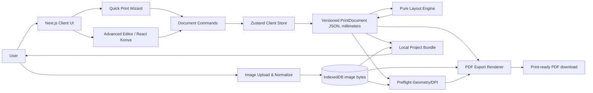

# SDMS Print Studio — Product & Architecture Plan

**Version:** 1.0 (planning baseline)  
**Date:** 2026-11-09  
**Project:** SDMS Print Studio (`sdms.digital`)  
**Status:** In progress. The local Quick Print build is available for testing.  
**Primary platform:** Responsive web application; desktop-first editing  
**Owner:** SDMS printing services

> **North star:** Upload one or more pictures, choose a measured template, set quantities, optionally edit the design, and download a correctly sized, print-ready multi-page PDF without manually arranging images in Photoshop.

## 1. Executive summary

SDMS Print Studio combines two workflows using a shared document model and export pipeline:

1. **Quick Print:** Upload photos; choose a size (1×1, 2×2, passport/visa, 3R/4R, sticker label); set copies, sheet, margins, and spacing; crop; let the layout engine populate pages; export a PDF.
2. **Advanced Designer:** Open a Canva-inspired editor with drag-and-drop image frames, images, text, vector shapes, page backgrounds, layers, transform handles, multi-page editing, reusable templates, and accurate PDF export.

The initial release is **local-first**: no account needed, no compulsory transfer of ID images to a server, browser-side rendering/export, user-controlled project downloads. Online orders, cloud storage, payments, AI background removal, and collaboration are later phases.

## 2. Objectives and measurable success

| Objective | Measurable acceptance target |
| --- | --- |
| Exact physical dimensions | PDF MediaBox matches selected sheet dimensions to within 0.1 mm (allowing normal PDF point precision). Printed calibration page is measured on supported printers at 100% scale. |
| Fast quick-print workflow | User can prepare 12 copies of a 2×2-inch image on A4 in fewer than 8 deliberate UI actions after selecting photos, excluding cropping adjustments. |
| Deterministic layouts | Identical input yields identical placements, page count, and ordering on repeat. |
| Export quality | Original image bytes are used or crops are rendered from original-resolution sources; DPI warnings appear below quality thresholds. |
| Recoverability | Project JSON and local assets can be reloaded; reload does not silently lose work if autosave is enabled. |
| Accessible editing | Core controls keyboard-accessible; non-canvas alternatives exist for position, size, crop, and layer operations. |
| Data privacy | File processing stays local in MVP. No uploads or analytics containing photo pixels. |
| Browser support | Latest supported Chrome, Edge, Firefox, Safari, including responsive preview on tablets. |

Targets are acceptance criteria, not measured performance claims. Establish benchmark devices and printers during QA.

## 3. Personas and workflows

- **Print-shop operator:** Quickly produces repeated ID photos and varied-sized prints on A4/Letter/4R using preset configurations.
- **Walk-in customer:** Supplies images, verifies cropping, requests quantities and background.
- **Self-service website customer (later):** Designs online, estimates costs, submits print job with approved proof.
- **Template administrator (later):** Creates standardized, versioned, reusable layouts and pricing rules.

### 3.1 Quick Print user journey

1. Select `Quick Print` and template (e.g., `2×2 in ID photo`).
2. Upload one or multiple PNG/JPEG photos.
3. For each photo, adjust crop and number of copies; optionally choose solid background **only where appropriate**.
4. Select paper (A4, Letter, Legal, photo paper), orientation, safety margin, and gap.
5. Review auto-packed page(s), effective image DPI, unused space, and count.
6. Export printable PDF; print at **Actual size / 100%**, not `Fit to page`.
7. Optionally save/download an editable project bundle.

### 3.2 Advanced Designer user journey

1. Start from blank paper or an existing template.
2. Add a page, drop in image frames, move/resize/rotate items; edit text and shapes.
3. Use layers, alignment, snapping, guides, multi-selection, undo/redo, and inspector fields.
4. Save as project or custom template; choose whether all elements are printable.
5. Validate overflow, minimum dimensions, missing assets/fonts, and low DPI.
6. Export a vector-first PDF, rasterizing only effects and image crops that require it.

## 4. Scope and release strategy

### MVP / Release 0.1 — **Must deliver**

- Template gallery: `1×1 in`, `2×2 in`, `35×45 mm` generic ID, `3R`, `4R`, blank A4.
- Paper definitions: A4, Letter, Legal, 4R, with portrait/landscape where applicable.
- PNG/JPEG image upload, orientation normalization, file validation, thumbnail, source metadata.
- Upload multiple images; per-image quantity; exact-dimension crop; basic image reordering.
- Uniform and mixed-size auto-layout with deterministic pagination, explicit margins and gaps.
- Optional **Fit all prints to one sheet**, with proportional size reduction and visible printed dimensions.
- Canvas preview with select, move, resize, rotate, duplicate, delete; numeric inspector.
- Initial editable document schema, page list, undo/redo, save/load as local project.
- Multi-page print-ready PDF, page-size correct, cut guides optional, DPI and overflow warnings.
- Responsive shell, error states, progress indicator, browser test coverage.

### Release 0.2 — Advanced design foundations

- Text tools, embedded fonts, rectangles/circles/lines, fills/strokes.
- Layer stack with locking, visibility, z-order, multi-select, grouping.
- Snapping, alignment/distribution, guides, rulers, keyboard shortcuts.
- Template creation, template versioning, custom page dimensions, customizable frames.
- Better cropping, image rotate/flip, brightness/contrast, bleed settings.
- IndexedDB autosave and portable project ZIP containing JSON + original image assets.

### Release 0.3 — Rich print scenarios

- Sticker sheets, label layouts, photobooth strips, collage, Polaroid frames.
- Presets with variant dimensions (country-specific ID/visa specs only after verification).
- Batch jobs, CSV-driven labels (with preview), special crop marks, safe areas.
- Print-job estimates, repeated artwork optimization, asset deduplication.

### Release 1.0 — Business integration (optional)

- Authentication/roles, cloud projects, cloud template library, storage/CDN.
- Pricing, quoting, online ordering, proof approval, checkout, and operator print queue.
- Audit history, access control, upload retention/deletion policies, admin console.
- Server-side conversion queue for larger jobs and optional PDF preflight.

### Explicitly out of MVP scope

AI background removal, live multi-user collaboration, commercial prepress PDF/X certification, automatic face/country-specific biometric compliance, CMYK color-managed workflow, color-profile embedding, bleed/trim imposition for commercial offset printing, in-browser printer-driver control, and true full Canva parity.

**Do not market the MVP PDF as PDF/X or professionally color-managed.** Exact page geometry alone does not guarantee identical colors across printers.

## 5. Template catalog and dimensions

All measurements stored in **millimeters**; displayed units can be inches/mm. Presets are editable and labeled as examples until verified against a customer's specific ID/passport requirement.

| Family | Examples | Nominal finished size |
| --- | --- | --- |
| ID photo | 1×1 in | 25.4 × 25.4 mm |
| ID photo | 2×2 in | 50.8 × 50.8 mm |
| Generic ID example | 35×45 mm | 35 × 45 mm |
| Generic ID example | 30×40 mm | 30 × 40 mm |
| Photo print | 3R | 88.9 × 127 mm (3.5 × 5 in) |
| Photo print | 4R | 101.6 × 152.4 mm (4 × 6 in) |
| Photo print | 5R | 127 × 177.8 mm (5 × 7 in) |
| Photo print | 8R | 203.2 × 254 mm (8 × 10 in) |
| Custom | Label/sticker sizes | User-supplied width and height |

The current Quick Print catalog has 32 presets across ID, wallet/R-series, square, large, and full-sheet photos. Every print entry has its own size, copies, crop, and frame orientation. A single source photo can have multiple entries. The starting-size picker applies to new uploads, and **Apply to all** updates existing entries together.

The catalog includes 1×1, 1.5×1.5, 2×2, 30×40 mm, 35×45 mm, 2×3 in, 2R, 3R, 4R, 5R, 6R, 8R, 8RW/S8R, 10R, 11R, 12R, 12RW/S12R, square prints from 3×3 through 6×6 plus 8×8, 8×11, 8×13, 16×20, 20×24, 20×30, 24×36, A5, A4, A3, and 13×19 in. The displayed dimensions identify each format, including the larger R-series variants.

Philippine lab offerings informed the ID and print selection. The dimension guide supplements the R-series and square formats. [Picture City ID packages](https://picturecity.ph/collections/id-and-passport-prints), [Picture City photo prints](https://picturecity.ph/collections/photo-prints), [Picture City large prints](https://picturecity.ph/collections/photo-prints/products/large-prints), [FotoHub dimension guide](https://eshop.fotohub.com/blog/photo-home-decor-print-size-guide).

**Paper presets** (physical MediaBox dimensions):

| Sheet | Width × height in mm | Notes |
| --- | --- | --- |
| A4 | 210 × 297 | Default for Philippine print-shop workflows |
| A5 | 148 × 210 | Optional |
| US Letter | 215.9 × 279.4 | 8.5 × 11 in |
| US Legal | 215.9 × 355.6 | 8.5 × 14 in |
| 4R | 101.6 × 152.4 | 4 × 6 in photo paper |
| 5R | 127 × 177.8 | 5 × 7 in photo paper |
| Custom | User-defined | Validate against printer maximum/minimum |

**Passport/visa warning:** A generic `35×45 mm` preset is not synonymous with compliance with Philippine or any other passport authority. Requirements can vary by country and application; verify the official current dimensions, face positioning, and background rules before labeling a preset as compliant.

## 6. Product UX and screen architecture

```text
Home / Templates Gallery
  ├── Quick Print Wizard
  │     ├── Template Picker
  │     ├── Upload & Image Queue
  │     ├── Crop & Quantity
  │     ├── Paper/Layout Settings
  │     └── Print Preview & Export
  ├── Advanced Designer
  │     ├── Top Toolbar (undo, redo, preview, print)
  │     ├── Left Tabs (templates, uploads, elements, text, pages)
  │     ├── Center Stage (paper + selection/transform)
  │     ├── Right Inspector (x/y/width/height/crop/style)
  │     ├── Bottom Page Navigator + Zoom
  │     └── Export/Preflight Dialog
  └── My Projects / Saved Templates (initially local)
```

**Important behaviors:** Zoom is visual only; never alter document measurements. Image pixel data is not in Zustand history. Use `canvas-only` manipulation with numeric/keyboard inspector fallback. Disable editing on locked elements, but still allow selection/read-only inspection. Show warnings but permit export when possible, unless hard-invalid geometry/missing required data.

### 6.1 SDMS Digital visual theme

Use the [SDMS Digital homepage](https://www.sdms.digital/) as the visual reference for the Studio. Reuse the SDMS logo, Unbounded for display headings, Instrument Sans for interface text, ink (`#15171C`), and the pale page background (`#F5F7FB`). Use rounded cards, pill-shaped primary buttons, and cyan, magenta, and yellow accents in the Studio home, template gallery, and Quick Print flow.

Carry the same typography and controls into the editor, with compact toolbars and a neutral surround for the paper preview. Keep brand styles in the application UI. The preview and exported PDF take their page colors and artwork from the print document.

Map the brand styles to shared Tailwind and shadcn/ui theme tokens. Use the existing site's theme values where available so Studio controls can be updated together.

## 7. Technology decisions

| Concern | Choice | Reason |
| --- | --- | --- |
| Web runtime | Current compatible Next.js App Router + React + TypeScript | Mature routing, deployment and future ordering API |
| UI | Tailwind CSS v4 + shadcn/ui | Fast, accessible, themeable product shell |
| Interactive canvas | `react-konva` + `konva` | React-declarative scene, drag, transformer, layers |
| State | Zustand with per-editor client instance | Predictable commands, undo/redo, separation from React Server Components |
| Validation | Zod | Validate imported projects, templates, assets, numeric inputs |
| PDF | `pdf-lib` + optional `@pdf-lib/fontkit` | Exact point-based page sizes, image/shape/text embedding |
| Local persistence | IndexedDB (e.g., `idb`) | Binary originals without localStorage quota/JSON bloat |
| Cropping | Browser Canvas API + optional crop UI library | Generate high-resolution image crops, independent of zoom |
| Tests | Vitest + Testing Library + Playwright | Geometry, state, PDF integration, user flows |
| Backend (later) | Next.js route handlers + Postgres/Supabase + object storage | Cloud jobs, permissions, ordering, billing |

**Versioning policy:** Install compatible current stable major versions and commit lockfile. `react-konva` major must align with React major. Do not blindly upgrade a printing release without golden export tests.

## 8. High-level architecture



### 8.1 Layer boundaries

- **UI components** dispatch domain actions and display state; do not implement geometry or PDF conversion inline.
- **Document model** is the canonical source of layout, dimension and appearance data (not `Stage.toJSON()`).
- **Editor view adapter** converts model mm to screen pixels at a preview scale and resolves asset thumbnails.
- **Layout engine** is a pure function from geometry, quantities, and configuration to placed element rectangles.
- **PDF renderer** consumes the same geometry/model but works in PDF points and original-resolution image bytes.
- **Asset repository** resolves binary photos using IDs; document JSON references image IDs only.
- **Preflight** validates imported assets, page bounds, DPI, paper compatibility and print settings.

### 8.2 Coordinates and geometry: non-negotiable

- Persist element origin at **top-left** as `(xMm, yMm)` with `widthMm`, `heightMm`, `rotationDeg`.
- Normalize angles and dimensions. Canvas pixel mapping: `screenPx = mm * previewPxPerMm`.
- PDF uses bottom-left origin. Position: `pdfX = mmToPt(xMm)`; `pdfY = mmToPt(sheetHeightMm - yMm - heightMm)` for unrotated rectangles/images.
- `mmToPt(mm) = mm * 72 / 25.4`.
- Sheet and element dimensions are independent of CSS zoom, display DPI, device pixel ratio, and thumbnail pixels.
- Handle rotated object bounding boxes in preflight/snap rules; do not treat rotation as unrotated width/height.
- `bleedMm`, `safeInsetMm`, `marginMm`, `gapMm` are distinct concepts.

## 9. Data model (summary)

See `DEVELOPER_GUIDE.md` for concrete TypeScript definitions. Core concepts:

- `PrintDocument`: schemaVersion, id, title, page IDs, pages, asset manifest, createdAt, updatedAt, originTemplateId.
- `PrintPage`: id, `widthMm`, `heightMm`, background, `elements[]`, optional bleed/safe insets.
- `PrintElement`: discriminated union (`image`, `rect`, `ellipse`, `line`, `text`, `group` later); common id, x/y/width/height mm, rotation, opacity, lock, hide, z order.
- `ImageElement`: assetId, fit mode, crop rectangle in original image pixels, optional background/effects.
- `ImageAsset`: id, fileType, intrinsic pixel width/height, checksum, orientation state, storage locator; binary stored separately.
- `Template`: stable ID/version, category/tags, sample document/paper, exposed user parameters; should not contain customer PII/photos.
- `QuickPrintJob`: line items `{ assetId, crop, photoSize, quantity }`, paper, gap, margin, cut guides, orientation.
- `ExportOptions`: paper selection, DPI target, cut guides, optional fit warnings, filename.
- `PreflightIssue`: severity, code, page/element, message, suggested action.

### Schema evolution

All project/template files include `schemaVersion` and undergo Zod validation. Support explicit migrations, e.g., 1→2 when changing crop representation. Never trust imported JSON or external asset paths.

## 10. Image pipeline

1. Accept PNG/JPEG first; reject other formats with useful errors (HEIC/WebP support can be added separately after testing).
2. Validate MIME/signature, size limits, width/height, count, total pixel budget; reject decompression-bomb-sized images.
3. Decode and normalize EXIF orientation; retain original bytes or generate a normalized master, according to crop transform design. Do not apply EXIF twice.
4. Generate low-memory thumbnails for the editor; save originals in IndexedDB under opaque asset IDs.
5. `ImageElement` references assetId plus a crop rectangle expressed relative to the **normalized full-resolution source image**.
6. For PDF export, use direct PNG/JPEG embedding when uncropped and supported; otherwise render **that single source image crop** at target output pixel dimensions. Never upscale a thumbnail or a screenshot of the whole canvas.
7. Effective resolution warning: `min(usedSourceWidthPx / (widthMm/25.4), usedSourceHeightPx / (heightMm/25.4))`, adapted for rotation and transformations.
8. Recommended targets: **300 DPI** ideal for standard photo printing, 150–299 DPI caution, below 150 DPI strong warning. These are practical heuristics, not a promise of print quality.
9. Respect aspect ratio, `cover` vs `contain`, fill/background, and any transparent pixels; maintain deterministic exports.

For especially high output counts, cache each unique crop result once per PDF, cache PDFImage objects, reuse originals and cap memory. Add cancellation and user-visible progress.

## 11. Automatic layout engine

### 11.1 Uniform grid formula

Let `W/H` = sheet in mm, `w/h` = finished photo in mm, `m` = margin on each edge, `g` = gap between items.

```text
columns = floor((W - 2m + g) / (w + g))
rows    = floor((H - 2m + g) / (h + g))
capacityPerPage = columns * rows
pageCount = ceil(totalCopies / capacityPerPage)
```

If columns or rows < 1, stop with `ITEM_DOES_NOT_FIT` rather than dividing by zero or silently shrinking the photos. Each cell is placed at `x = margin + column * (photoWidth + gap)` and `y = margin + row * (photoHeight + gap)`.

**Worked A4 example:** 2×2 in (50.8×50.8 mm), 5 mm margin, 3 mm gap on A4 portrait (210×297 mm) fits **3 columns × 5 rows = 15 photos per page**. Twelve copies occupy one page (four rows of three); extra space is expected. Do not stretch photos to fill the page.

### 11.2 Multiple image sources

Flatten each line item into stable copy references, e.g., `photo-A × 6`, `photo-B × 3`, `photo-C × 3`. Support user-selected ordering (`grouped by photo` initially, `round-robin` later). Crop state can differ per line item without altering the original asset.

### 11.3 Mixed dimensions

The current Quick Print build supports multiple finished sizes on the same sheet. Uniform jobs retain their grid layout. Mixed jobs use deterministic rectangle packing, processing entries in list order and filling available space on earlier sheets before adding another page. Each placement reserves the requested gap and stays inside the margins. Its source crop and physical dimensions travel together to the preview and PDF renderer.

The user chooses frame orientation per entry. Paper size remains a separate setting. An entry that cannot fit stops export with a message to adjust the paper, orientation, or margins. This packing strategy can leave unused space.

### 11.4 Fit all prints to one sheet

The user can enable this option in sheet settings. It preserves copy counts, source crops, aspect ratios, margins, and gaps while scaling all finished photo sizes together when needed. Uniform jobs choose the largest scale that fits a grid. Mixed jobs start with a guaranteed grid layout, then try larger scales using the mixed rectangle packer. The resulting geometry is shared by preview and PDF export.

The preview shows the print scale, and each entry shows its selected and printed dimensions. For example, sixteen 2×2 prints on A4 with 5 mm margins and a 3 mm gap fit as 47.75 mm squares. Turning the option off restores the selected dimensions and regular pagination. Excessive margins or gaps produce an actionable error when a one-sheet layout is impossible.

## 12. Export pipeline and print correctness

```text
Preflight document + assets
 -> Create PDFDocument
 -> Add each page at exact paper points
 -> Draw paper background + vector shapes/text
 -> Resolve high-res image crop and embed PNG/JPEG
 -> Draw cut marks if enabled, kept inside page bounds
 -> Save PDF bytes
 -> Offer download, preview, and print instructions
```

- Export geometry must come from the document model, not `Stage.toDataURL()`; otherwise the whole design becomes pixelated at screen resolution.
- Embed font files only where their redistribution license permits; register `fontkit` for nonstandard fonts and Unicode when needed.
- Map image crop, rotation, opacity and clipping consistently in both engines; document which advanced canvas effects still require raster fallback.
- Do not automatically add print scaling, padding, or fit-to-page.
- Multi-page PDFs must retain exact page order and size; avoid mixing sheet sizes unless clearly surfaced.
- Ensure transparent PNG semantics and deliberate backgrounds; PDF white paper is not the same as prefilled white pixels.
- Cut marks/trim lines must be inside printable area, and users must understand most home printers have non-printable margins.
- For native print dialogs instruct `Actual size`, `100% scale`, correct media, orientation, and borderless setting **only on supported hardware**.
- `pdf-lib` provides exact point-based pages and drawing primitives, but does not itself provide certified prepress PDF/X output or end-to-end ICC/CMYK management.

## 13. State and persistence

- Keep one editor store **per mounted editor instance**, client-side only. Never read a module-global mutable editor store from server components or use it across requests.
- Domain actions: `addElements`, `updateElement`, `moveElements`, `reorderElements`, `setCrop`, `replacePage`, `applyTemplate`, `undo`, `redo`.
- History snapshots should store small, serializable **document JSON**, not image blobs or Konva nodes; consolidate a drag gesture into one history entry on pointer release.
- History cap initially 50 transactions; use patch/inverse-patch approach if snapshots become large.
- Autosave small manifest to IndexedDB; store binary assets separately. Use versioned keys, migrations and storage-quota diagnostics.
- Support explicit `.sdms.zip` project export including manifest JSON + originals, and import validation. `.json` alone cannot transport binary images unless files are already present on that device.
- Avoid large base64 strings or binary arrays in localStorage/Zustand persist.

## 14. Components and module boundaries

```text
src/
  app/
    (marketing)/page.tsx
    (studio)/templates/page.tsx
    (studio)/quick-print/page.tsx
    (studio)/editor/[projectId]/page.tsx
    globals.css
  components/
    ui/                       # generated shadcn/ui components
    studio/
      StudioShell.tsx
      TemplateGallery.tsx
      QuickPrintWizard.tsx
      UploadQueue.tsx
      CropDialog.tsx
      PaperSettings.tsx
      PageNavigator.tsx
      PrintPreview.tsx
      ExportDialog.tsx
      PreflightPanel.tsx
    editor/
      EditorShell.tsx
      EditorCanvas.tsx          # client-only, react-konva
      CanvasElement.tsx
      SelectionTransformer.tsx
      LeftSidebar.tsx
      PropertiesInspector.tsx
      LayersPanel.tsx
      Toolbar.tsx
  features/
    documents/                 # types, schema, migrations, commands
    assets/                    # normalization, IndexedDB, thumbnails
    templates/                 # catalog, validation, presets
    layout/                    # uniform grid and mixed size packing
    editor/                    # state, history, keyboard, snap logic
    print/                     # geometry, preflight, PDF export
  lib/
    units.ts
    ids.ts
    errors.ts
  tests/
    unit/
    integration/
    e2e/
  public/
    templates/                 # public demo placeholders only
```

Render the Konva stage in a client-only component; keep unrelated Next.js routes/components server-rendered where practical.

## 15. API/route roadmap

**MVP:** No upload or export API required: local HTML File API, IndexedDB, and browser-side pdf-lib.

**Future:** `GET /api/templates`, `POST /api/projects`, `GET /api/projects/:id`, `PATCH /api/projects/:id`, `POST /api/assets/upload-url`, `POST /api/orders`, `GET /api/orders/:id`, `POST /api/exports`. All authenticated writes require server ownership checks, signed uploads, quota enforcement, content validation, rate limits and retention limits. Never expose private IDs or object-storage keys unprotected.

## 16. Security, privacy, accessibility, performance

- **Privacy:** ID/passport photos are sensitive. No third-party image processor by default. Give users deletion/export controls. Avoid telemetry with images, filenames, or full document JSON. Clearly disclose any future cloud transfer/retention.
- **File safety:** Reject unsupported file types and maliciously large images; do not trust extension/MIME alone. Guard image decoding and imported template fields. Do not interpret arbitrary HTML/SVG/code from a template.
- **Resource limits:** Configurable caps (initial development defaults: 20 MB/file, 30 files/job, 100 MP decoded aggregate; tune against QA devices). Detect browser memory failures and reduce export parallelism.
- **Accessibility:** All tools have accessible labels, focus behavior and numeric inspectors; keyboard operations for items and pages. Important warnings not conveyed by color alone.
- **Performance:** Lazy-load Konva/editor, virtualize large template lists, use previews separate from masters, avoid storing images in React state, batch layout updates, reuse decoded assets, release object URLs.
- **Recovery:** Autosave with state indicators and explicit export; test crash/reload/quota failure and offline scenarios.

## 17. Quality plan

### Geometry unit tests

- `mmToPt(25.4) === 72` within floating-point tolerance.
- A4 PDF page is 210×297 mm when page sizes are read back from PDF points.
- A4 portrait / 2×2-in photos / margin 5 mm / gap 3 mm produces 3×5 layout, capacity 15.
- Zero copies yields zero placement (choose whether to export zero pages or provide a helpful warning).
- Impossible sizes yield explicit error.
- Element bounding boxes never exceed sheet bounds unless marked intentional bleed and valid.
- Orientation/rotation, crop clipping, fit, transparency and repeated images produce matching preview/export.

### Integration tests

- Upload/normalize, crop, layout, PDF export, reimport, and multi-page order.
- Low-DPI warnings and missing image assets; cancelled export; large image memory handling.
- Undo/redo for drag, property update, deletion, template application.
- Local project bundle includes all asset references and works on another device.

### Print acceptance

- Print and physically measure a 100 mm reference line, 1×1 in and 2×2 in squares on at least two representative printers.
- Test A4, Letter, 4R, portrait/landscape, with/without borderless modes.
- Compare final cut dimensions to source geometry. Check user instructions for `100% / Actual size`.
- Record printer model, OS, print dialog, scaling, margin setting and measured tolerances.

## 18. Release gates

- **Gate A: Geometry validated.** Unit tests + PDF readback + printer calibration pass.
- **Gate B: Quick Print functional.** Upload → crop → quantity → layout → PDF, including overflow, in 3 supported browsers.
- **Gate C: Designer usable.** Transform and re-edit elements, undo/redo, persistence and export parity.
- **Gate D: Public release.** Privacy notice, error handling, reliable downloads, responsive layout, accessibility, regression suite.

## 19. Open design decisions to resolve before implementation

| Decision | Recommended default |
| --- | --- |
| First templates | 1×1, 2×2, generic 35×45 mm, 3R, 4R |
| Default sheet | A4 portrait, 5 mm margins, 3 mm gap |
| Layout mode | Uniform grid for matching sizes; deterministic rectangle packing for mixed sizes |
| Crop state | Source-pixel rectangle from normalized original image |
| Default print quality | Target 300 DPI, warning below 300, critical below 150 |
| Project save | Browser IndexedDB + portable ZIP export; no cloud |
| Identity-photo compliance | User-verified; no automatic governmental compliance claims |
| Order integration | Deferred until PDF quality and layout stability |
| Export memory cap | Tested per supported browser; fail gracefully |

## 20. Official references

- Next.js App Router / installation: https://nextjs.org/docs/app/getting-started/installation
- Tailwind CSS (Next.js): https://tailwindcss.com/docs/installation/framework-guides/nextjs
- shadcn/ui (Next.js): https://ui.shadcn.com/docs/installation/next
- React Konva overview: https://konvajs.org/docs/react/index.html
- React Konva transformer: https://konvajs.org/docs/react/Transformer.html
- Konva state best practices: https://konvajs.org/docs/data_and_serialization/Best_Practices.html
- pdf-lib: https://pdf-lib.js.org/
- pdf-lib PDFPage API: https://pdf-lib.js.org/docs/api/classes/pdfpage
- Zustand and Next.js: https://zustand.docs.pmnd.rs/learn/guides/nextjs
- Zustand persistence: https://zustand.docs.pmnd.rs/reference/integrations/persisting-store-data

**Related files:** `TASKS.md` (delivery backlog), `DEVELOPER_GUIDE.md` (implementation patterns and examples).
